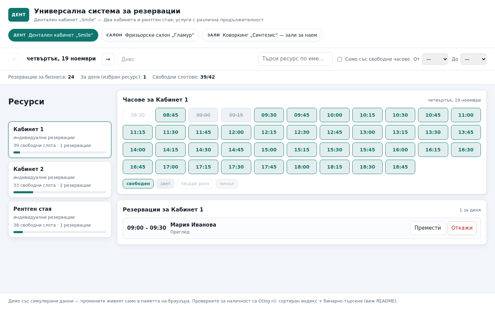
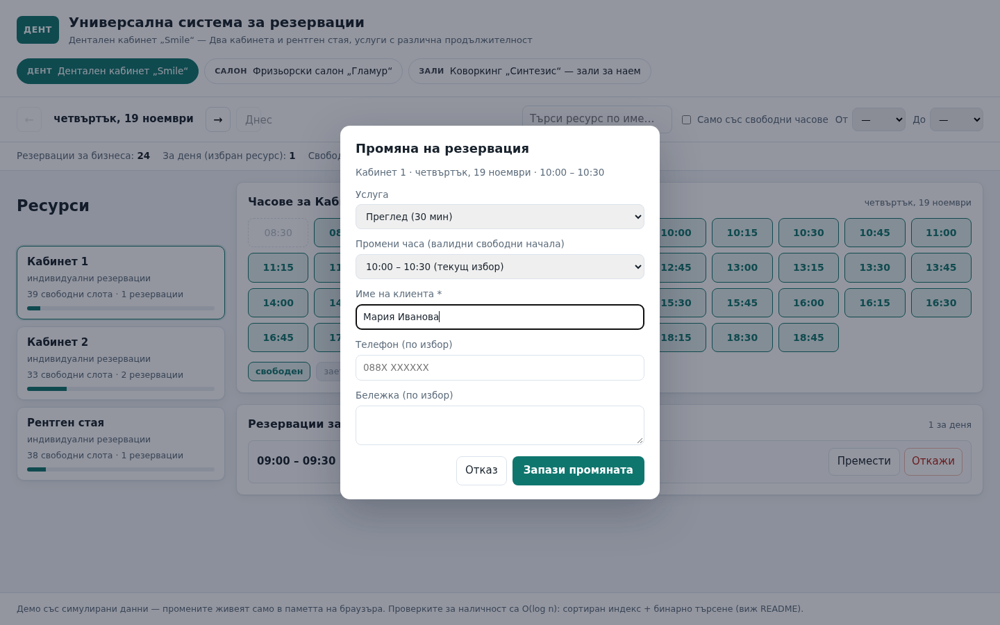
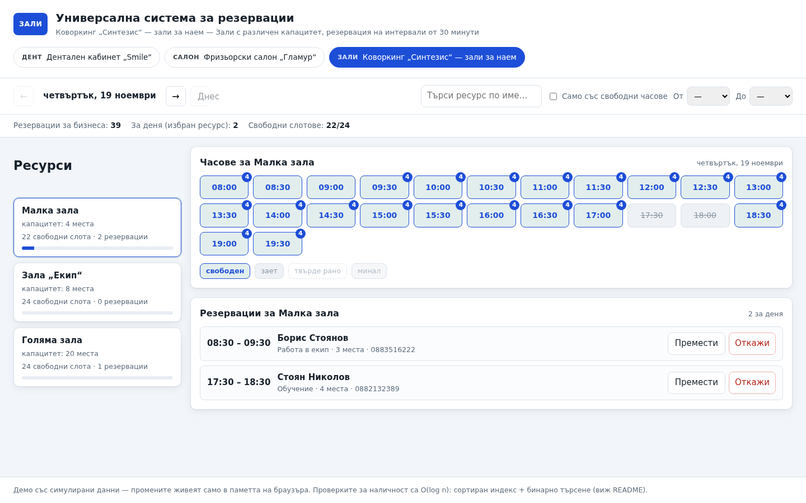

# Универсална система за резервации

Адаптивно приложение за резервации, което се НАСТРОЙВА чрез конфигурация за различни типове бизнес — дентален кабинет, фризьорски салон и коворкинг зали. Изградено с **React + Vite** и **симулирани данни** (без бекенд). Фокусът е върху общ конфигурируем модел, ефективни алгоритми за наличност/конфликти и чисто управление на състоянието.



---

## 1. Стартиране

Изискава Node.js 18+.

```bash
npm install          # инсталира зависимостите
npm run dev          # dev сървър на http://localhost:5173
npm run build        # production build в dist/
npm run preview      # сервира готовия build на http://localhost:4173
npm run test:logic   # smoke тестове за логиката (чист Node, без браузър)
```

## 2. Основен потребителски поток

1. **Превключване на бизнес конфигурация** — табовете в горната лента (ДЕНТ / САЛОН / ЗАЛИ). Темата, ресурсите, услугите и правилата се сменят мигновено, без презареждане.
2. **Избор на ден** — навигацията по дата спазва хоризонта на конфигурацията (макс. N дни напред, без минали дни).
3. **Филтриране на наличност** — търсене на ресурс по име, „само със свободни часове", ограничение на времевия диапазон (От / До).
4. **Създаване на резервация** — клик върху свободен слот, избор на услуга (или продължителност за залите), брой места за групови ресурси, име на клиента. Валидацията отблъсква припокривания, извънработно време и твърде ранни часове; при конфликт бутонът „Покажи първия свободен час" намира автоматично следващата възможност.
5. **Промяна (преместване)** — бутон „Премести" в списъка с резервации; диалогът показва всички ВАЛИДНИ свободни начала за деня.
6. **Отказ** — бутон „Откажи" с потвърждение.



## 3. Архитектура

Приложението е разделено на четири слоя — конфигурация, логика, състояние и представяне. Логиката е изцяло чисти функции, които могат да се тестват без браузър (`npm run test:logic`).

```
src/
├── main.jsx                 # входна точка (React root)
├── App.jsx                  # композиция на екрана и потока на данните
├── styles.css               # стилове (без UI библиотеки)
├── config/
│   └── businessConfigs.js   # УНИВЕРСАЛНИЯТ модел: 3 бизнес конфигурации
├── data/
│   └── simulatedData.js     # детерминистичен генератор на симулирани резервации
├── logic/
│   ├── slots.js             # работно време, генериране и оцветяване на слотове
│   ├── conflicts.js         # сортиран индекс + бинарно търсене на конфликти
│   └── validation.js        # централизирани бизнес правила (валидации)
├── state/
│   ├── store.jsx            # Context + useReducer, нормализирано състояние
│   └── useNow.js            # „сега" — опреснява се веднъж на минута
└── components/
    ├── BusinessTabs.jsx     # превключване на бизнес конфигурация
    ├── Toolbar.jsx          # дата + филтри за наличност
    ├── ResourcePanel.jsx    # ресурси: свободни слотове и натовареност
    ├── SlotGrid.jsx         # мрежа от слотове (мемоизирани чипове)
    ├── DayBookings.jsx      # списък резервации: преместване и отказ
    ├── BookingDialog.jsx    # създаване/промяна с валидация
    └── StatsBar.jsx         # обобщени показатели
```

Поток на данните (еднопосочен):

```
потребителско действие -> dispatch(action) -> reducer (чист) -> нов state
      -> мемоизиран индекс (ресурс+ден -> сортиран масив)
      -> мемоизирани слотове/филтри -> мемоизирани компоненти
```

## 4. Модел на данните

### 4.1 Конфигурация на бизнес (`BusinessConfig`)

| Поле | Значение |
|---|---|
| `id`, `name`, `shortLabel`, `description`, `color` | идентичност и тема в интерфейса |
| `slotGranularityMin` | стъпка на мрежата от слотове (15 мин за кабинет/салон, 30 мин за зали) |
| `defaultDurationMin`, `maxDurationMin` | продължителност, когато няма услуги (наем на зали) |
| `leadTimeMin` | колко минути предварително трябва да е поискана резервацията |
| `maxAdvanceDays` | максимален хоризонт за резервация напред |
| `workingHours` | работно време по дни (`1` = понеделник ... `6` = събота, `0` = неделя); липсващ ключ = почивен ден |
| `resources[]` | резервирани обекти; `capacity > 1` = групов ресурс (зала с места) |
| `services[]` | услуги с фиксирана продължителност; празен списък = избор на продължителност |
| `bookingTitles[]` | типови названия за бизнес без услуги |

### 4.2 Резервация (`Booking`)

```js
{
  id: 'sim-dental-12',          // уникален идентификатор
  businessId: 'dental',         // към кой бизнес принадлежи
  resourceId: 'cab1',           // кой ресурс е резервиран
  serviceId: 'filling',         // услуга (или null)
  title: 'Пломба',              // име за показване
  customer: 'Мария Иванова',
  phone: '088XXXXXXX',
  note: '',
  start: 1795078800000,         // epoch ms (начало)
  end:   1795079400000,         // epoch ms (край, полуотворен интервал)
  dateKey: '2026-11-19',        // ден (за индексиране)
  seatsUsed: 1                  // заети места (при залите)
}
```

### 4.3 Универсалност — нов бизнес = нов обект

Нито един ред логика или интерфейс не знае за конкретен бизнес. Добавяне на например масажен салон:

```js
{
  id: 'massage',
  shortLabel: 'МАСАЖ',
  name: 'Масажен студио „Релакс“',
  color: '#7c3aed',
  slotGranularityMin: 15,
  defaultDurationMin: 60,
  leadTimeMin: 120,
  maxAdvanceDays: 10,
  workingHours: { 1: { start: '10:00', end: '20:00' }, 2: { start: '10:00', end: '20:00' } },
  resources: [{ id: 'room1', name: 'Стая 1', capacity: 1 }],
  services: [{ id: 'classic', name: 'Класически масаж', durationMin: 60 }],
}
```

Три демонстрирани варианта на „универсалност“:

| Бизнес | Грануларност | Услуги | Капацитет | Особеност |
|---|---|---|---|---|
| Дентален кабинет | 15 мин | да, 30–90 мин | индивидуален | lead time 60 мин, събота почивен |
| Фризьорски салон | 15 мин | да, 30–120 мин | индивидуален (по майстор) | работи и в събота |
| Коворкинг зали | 30 мин | не — избор на продължителност | 4 / 8 / 20 места | групови резервации, брой места |

## 5. Ефективност и оптимизация

### 5.1 Структура от данни: сортиран масив + бинарно търсене

За всеки (бизнес, ресурс, ден) резервациите се пазят в масив, **сортиран по начало** (`buildResourceIndex` в `store.jsx`, вмъкване с `insertSorted` — `lowerBound`, O(log n)).

Проверката за конфликт (`findConflicts`) НЕ сканира всички резервации. Бинарно търсене намира първия възможен кандидат — резервация не може да припокрива интервала, ако е започнала по-рано от `начало − maxSpan` (maxSpan = най-дългата услуга на конфигурацията). След това се разглежда само малък „прозорец“ от кандидати.

**Сложност: O(log n + k)** вместо O(n) — при n резервации на ден и k конфликти в прозореца.

### 5.2 Линейно оцветяване на слотовете (two-pointer)

`decorateSlots` обединява слотовете и резервациите в **O(S + n)**: двата списъка са сортирани по време, а указател върху резервациите се движи само напред. Не е нужна матрица S × n.

### 5.3 Нормализирано състояние и идемпотентен reducer

- Резервациите живеят в обект по id (`byId` + `allIds`) — O(1) достъп, копира се само засегнатият запис.
- Действията са идемпотентни: повторен `ADD_BOOKING`, `SET_BUSINESS` със същата стойност и т.н. връщат **същата референция** на state, а React пропуска рендер.

### 5.4 Извличане вместо синхронизация (derive, не sync)

Наличността, слотовете, натовареността и статуските **никога не се съхраняват** в състоянието — винаги се изчисляват от конфигурация + резервации. Така е невъзможно състоянието и изводът да се разхедносинхронизират, а преизчисленията се контролират с `useMemo`:

| Изчисление | Ключ на мемоизацията |
|---|---|
| индекс „ресурс+ден -> сортиран масив“ | `bookings.byId` (веднъж на промяна на данните) |
| оцветени слотове за избрания ресурс | конфигурация, дата, резервации за деня, `now` |
| обобщение за всички ресурси | конфигурация, дата, индекс, `now` |
| видими ресурси / видими слотове | обобщения / филтри |

### 5.5 Мемоизация на компонентите

- `React.memo`: чип за слот (`SlotChip`), карта на ресурс (`ResourceCard`), ред на резервация (`BookingRow`) — преизчертават се само при реална промяна на техните props.
- Обработчиците, минаващи надолу, са стабилни (`useCallback`), затова memo-компонентите наистина се пропускат.
- „Сега“ се опреснява на **минута** (`useNow(60000)`), не на секунда — коректност за минали часове/lead time без излишни рендери.
- `key` на чиповете е самото начало на слота — стабилно при всяко преизчисление.

### 5.6 Сводна таблица със сложности

| Операция | Алгоритъм | Сложност |
|---|---|---|
| Проверка за конфликт / наличност | сортиран масив + lowerBound + ограничен обход | O(log n + k) |
| Вмъкване на резервация в индекса | lowerBound + splice | O(log n) + O(n) преместване |
| Строенето на индекса при промяна | веднъж на промяна на данните | O(N log N), N ~ 150 |
| Оцветяване на слотовете за ден | two-pointer обединение | O(S + n) |
| Генериране на слотове за ден | линейно по грануларност | O(S) |
| Търсене на следващ свободен час | findNextFreeStart (скача след конфликтите) | O(log n) на стъпка |

(n = резервации за ресурс и ден, S = слотове за деня, k = припокривания в прозореца, N = всички симулирани резервации)

## 6. Валидации (централизирани в `logic/validation.js`)

1. Име на клиента — поне 2 символа.
2. Lead time — не по-рано от `сега + leadTimeMin` (по конфигурация: 60/30/0 мин).
3. Хоризонт — най-много `maxAdvanceDays` дни напред.
4. Работно време — интервалът трябва да е вътре в работните часове за деня; почивен ден = отказ.
5. Припокриване/капацитет — при индивидуален ресурс: без припокривания; при зала: заетите места + новите не превишават капацитета.
6. При промяна собствената резервация се изключва от проверката (`excludeId`).

## 7. Симулирани данни

- Детерминистичен ГПСЧ (mulberry32, фиксиран seed) — при всяко пускане **едни и същи** данни, удобно за защита и демо.
- За всяка конфигурация: резервации за следващите 10 дни, ~3–6 на ден за ресурс, дължина по услуга/конфигурация, имена и телефони от списъци.
- Генераторът преминава през **същата** логика за конфликти (`findConflicts`) — симулираните данни са винаги коректни.
- Обем: около 100–150 резервации общо — достатъчно, за да се видят статуските и натовареността, при проверки от порядъка на микросекунди.

`npm run test:logic` проверява свойствата на данните (работно време, lead time, капацитет) и крайните случаи на алгоритмите (по-ран дълъг интервал, полуотворени граници, капацитет, стабилен ред).

## 8. Качество на кода и UX

- Чиста слоиста структура; логиката е чисти функции, покрити с smoke тестове (27 проверки).
- Без външни UI библиотеки; последователен визуален език с акцентен цвят на активния бизнес.
- Пътни съобщения за всяко действие (toast), потвърждение при отказ, ясни причини за неактивни слотове (подсказка при задържане).
- Адаптивна подредба (мобилни екрани: панелът с ресурси отива над графика).



## 9. Екип:
Илиян 11a Nomer: 14
